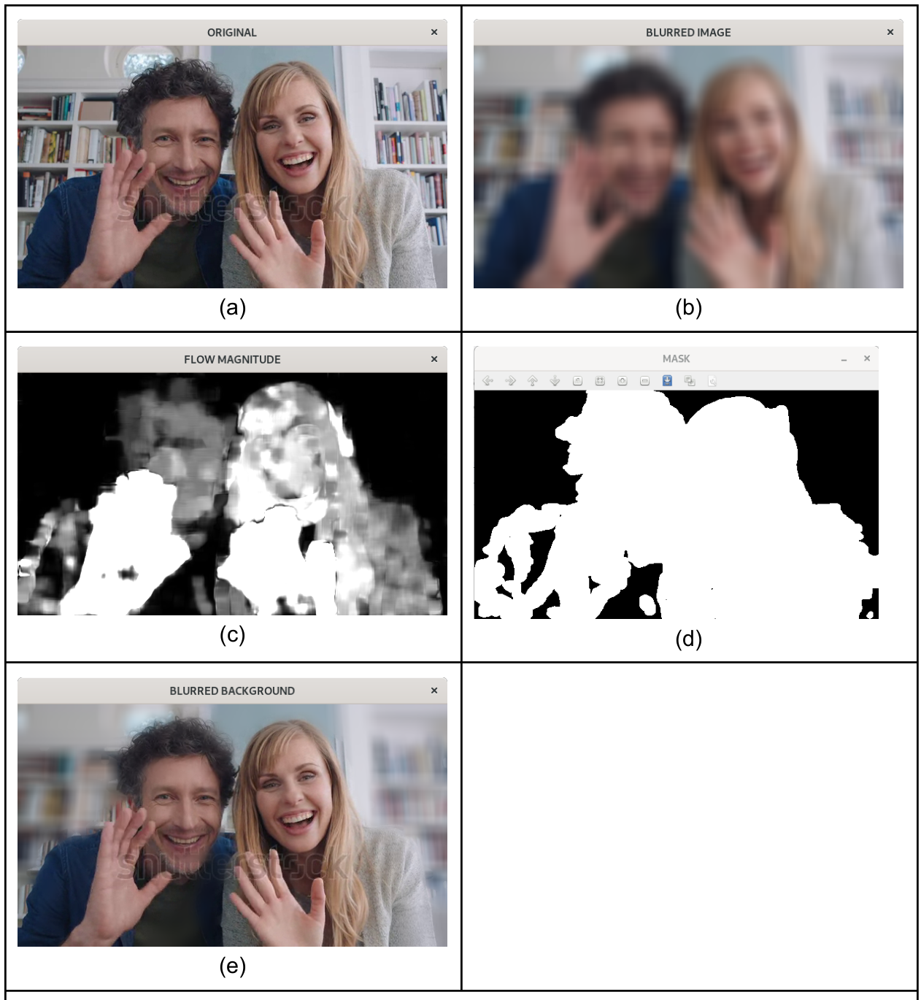

# Suavizado del Fondo basado en Flujo Óptico

© 2023- F.J. Madrid Cuevas (fjmadrid@uco.es). Universidad de Córdoba. España.

## Objetivos

* Aprender a calcular el flujo óptico entre pares de frames.
* Aprender a usar el flujo óptico como característica para separar primer plano del segundo plano.
* Aprender a usar “running average” cómo técnica para modelar la memoria de un sistema.

## Descripción

En esta práctica vamos a recrear el efecto de suavizado del fondo que vemos en aplicaciones de videoconferencia comerciales conocidas, por ejemplo. Zoom o Skype.

La idea es detectar en la imagen qué parte es el fondo de la escena y qué parte es la persona que está hablando. De esta forma podremos aplicar un suavizado de forma selectiva al fondo de la escena y combinarlo con el primer plano sin suavizar creando el efecto mencionado.

Para detectar las partes Fondo (“background”) y Primer Plano (“foreground”) usaremos como característica la magnitud del “flujo óptico” obtenido entre dos “frames” consecutivos de la fuente de video, ya que asumimos que el fondo de la escena es estático y que sólo la persona (primer plano) se mueve al hablar.

De forma esquemática los pasos a seguir son:

1. Capturar un nuevo frame.
2. Estimar el flujo óptico entre el frame anterior y el nuevo. Usaremos el algoritmo de Gunnar Farneback (`cv::FarnebackOpticalFlow`).
3. Calcular la magnitud del flujo óptico estimado.
4. Umbralizar la magnitud del flujo óptico para detectar las zonas de la imagen con movimiento aparente. Esto genera la máscara actual del primer plano. Esta máscara es postprocesada con operador morfológico de dilatación para cerrar posibles huecos interiores y extender la zona detectada para asegurar que el primer plano no sea afectado por el suavizado.
5. Actualizar la máscara con un “running average” de la forma:

$$m = \alpha \cdot m_{old} + (1 - \alpha) \cdot m_{new}$$

siendo $\alpha$ el factor de memoria del sistema.

6. Combinar una versión suavizada del nuevo frame con dicho frame usando la máscara del foreground calculada.

La Figura 1 muestra un ejemplo del proceso a realizar.

**Figura 1.** Ejemplo de aplicación. a) Imagen original. b) Imagen suavizada (con filtro box 11x11). c) Magnitud del flujo óptico con el frame anterior. d) Máscara usando un umbral t=0.5 pixeles para el flujo óptico sin normalizar, dilatación con radio=5 y un factor de memoria alfa=0.8. e) Imagen resultante de combinar la original con la suavizada utilizando la máscara generada. Imágenes tomadas del vídeo de prueba.

## Evaluación

| Funcionalidad | Puntos (hasta) |
| :--- | :--- |
| `test_common_code` | hasta 5 |
| Descripción de la técnica y el efecto de los parámetros en el vídeo | hasta 5 |
