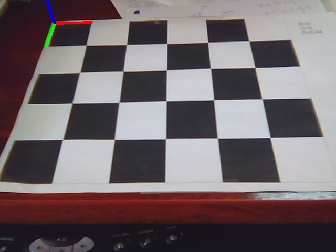
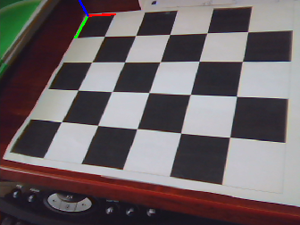
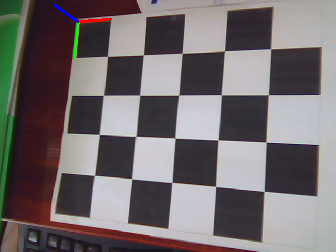
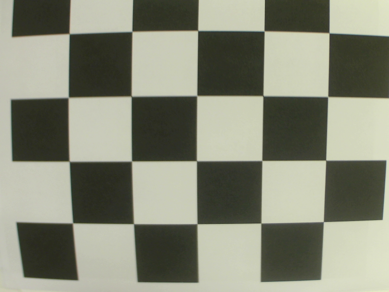
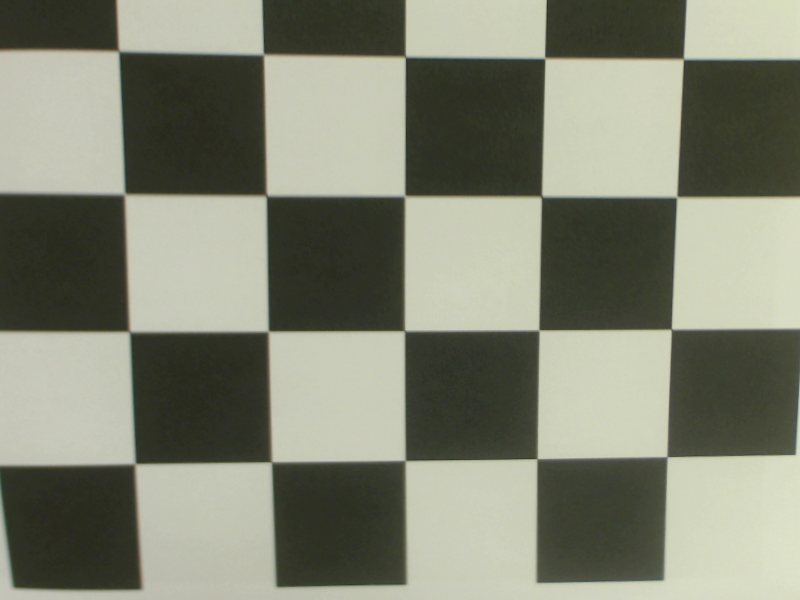

# Calibración de la cámara con OpenCV

© 2021- F.J. Madrid Cuevas (fjmadrid@uco.es). Universidad de Córdoba. España.

## Objetivos

* Aprender a calibrar una cámara usando OpenCV.
* Aprender a usar la funcionalidad de OpenCV para el almacenamiento persistente de datos.
* Aprender a utilizar la información de calibración para corregir la distorsión de la lente.
* Aprender a leer y escribir fuentes de video.

## Descripción

### Obtención de los parámetros intrínsecos

La calibración de la cámara es un proceso por el cual vamos a obtener sus parámetros intrínsecos: $f_x$, $f_y$, $c_x$, $c_y$ y los coeficientes de distorsión radial $k_1$, $k_2$ y $k_3$ y tangencial $p_1$ y $p_2$.

Para obtener estos parámetros necesitaremos utilizar un tablero con una cuadrícula tipo tablero de ajedrez, pero teniendo en cuenta que se necesita que la suma del número de columnas y el número de filas sea un número impar. Este tablero usará un tamaño de cuadro conocido que estará medido en las unidades del sistema de referencias requerido, normalmente en metros.

La calibración consistirá en obtener con la cámara varias vistas del tablero (unas nueve) y para cada vista realizar los pasos siguientes:

1. Detectar el tablero en una nueva vista con `cv::findChessboardCorners`,
2. Si el tablero ha sido detectado, refinar las coordenadas de las esquinas detectadas con `cv::cornerSubPix`.
3. Mostrar la imagen con las esquinas refinadas con `cv::drawChessboardCorners` y añadir las correspondencias de puntos 3D (del tablero) con puntos 2D detectados a los correspondientes vectores de puntos (ver `cv::calibrateCamera`).
4. Si no tenemos aún suficientes vistas ir al paso 1.
5. Finalmente utilizamos la función `cv::calibrateCamera` para obtener los parámetros intrínsecos de la cámara.

Para poder reutilizar estos parámetros, estos serán almacenados en un fichero. OpenCV ofrece la clase `cv::FileStorage` para realizar almacenamiento persistente de datos utilizando varios formatos como “YML”, “XML” o “JSON” (ver Figura 1).

Los parámetros a almacenar son los siguientes:

* La etiqueta `“image-width”`, es el ancho en píxeles de la cámara.
* La etiqueta `“image-height”`, es el alto en píxeles de la cámara.
* La etiqueta `“error”`, es el error de reproyección obtenido tras la calibración (ver `cv::calibrateCamera`).
* La etiqueta `“camera-matrix”`, es la matriz de cámara obtenida (ver `cv::calibrateCamera`).
* La etiqueta `“distortion-coefficients”`, son los coeficientes de distorsión de la cámara calculados (ver `cv::calibrateCamera`).
* La etiqueta `“rvec”` para el vector de rotación. Por defecto es un vector de tres valores a cero.
* La etiqueta `“tvec”` para el vector de traslación. Por defecto es un vector de tres valores a cero.

**Figura 1:** Ejemplo de fichero de calibración en formato “.xml”.

Normalmente suele ser interesante, para tener una evaluación visual de la calidad de la calibración realizada, mostrar los ejes 3D del sistema de referencias proyectados en cada una de las vistas en las que el patrón de calibración fue correctamente detectado. De esta forma podemos comprobar visualmente la alineación de los ejes con el patrón (Ver Figura 2).

**Figura 2.** Ejemplos de proyección de los ejes 3D sobre vistas del patrón. El tamaño del cuadro es de 3 cm.

### Corrección de la distorsión producida por la lente

Una de las aplicaciones de los parámetros intrínsecos es corregir la distorsión provocada por la lente. Para ello utilizaremos la función `cv::undistort` (ver Figura 3).

| Con distorsión | Corregida |
| :---: | :---: |
|  |  |

**Figura 3:** Ejemplo de imagen con distorsión (izquierda) y corregida (derecha).

Si vamos a corregir la distorsión en una fuente de video, para acelerar el proceso, es mejor primero crear los mapas para realizar la transformación (`cv::initUndistortRectifyMap()`) una sola vez para todo el vídeo y después en cada “frame” capturado aplicar los mapas (`cv::remap()`).

Para capturar desde una fuente de vídeo usaremos la clase `cv::VideoCapture`. Para crear un video donde almacenar el vídeo corregido usaremos la clase `cv::VideoWriter`.

Hay que tener en cuenta que dependerá de cómo se haya compilado/instalado OpenCV el poder utilizar más o menos codecs de vídeo o capturar desde distinto hardware.

## Evaluación

La evaluación de la práctica será la siguiente:

| Concepto. | Puntos (hasta). |
| :--- | :--- |
| `test_common_code` | hasta 5 |
| Descripción de la ejecución de los programas ‘calibrate’ para realizar una calibración (se valorará que calibres tu propia cámara) y ‘undistort’ con los datos de la cámara “logitech.zip”. | hasta 5 |

## Recursos

OpenCV docs: [https://docs.opencv.org/4.5.5/](https://docs.opencv.org/4.5.5/)
