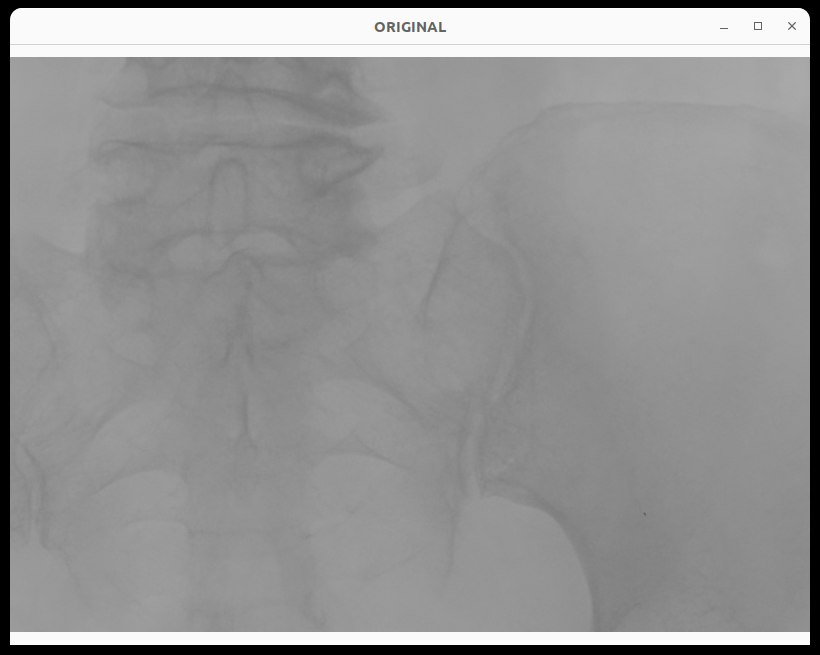
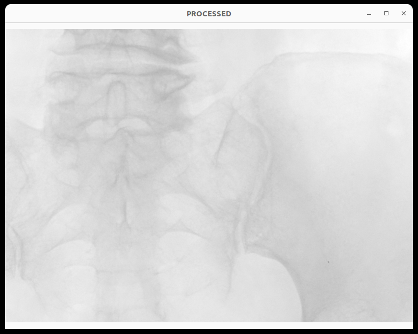
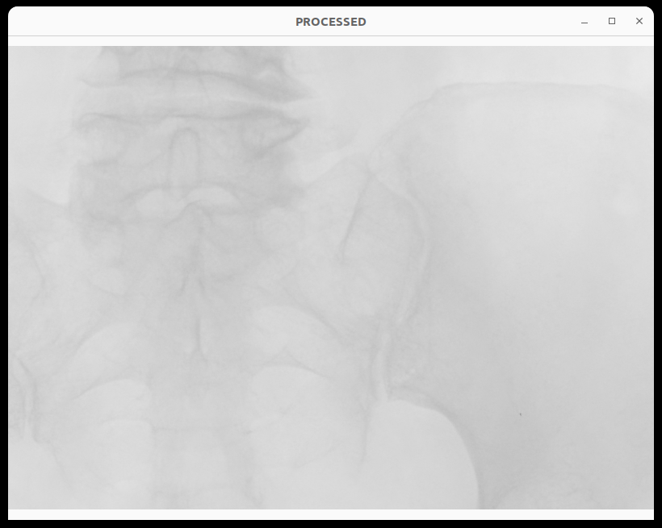
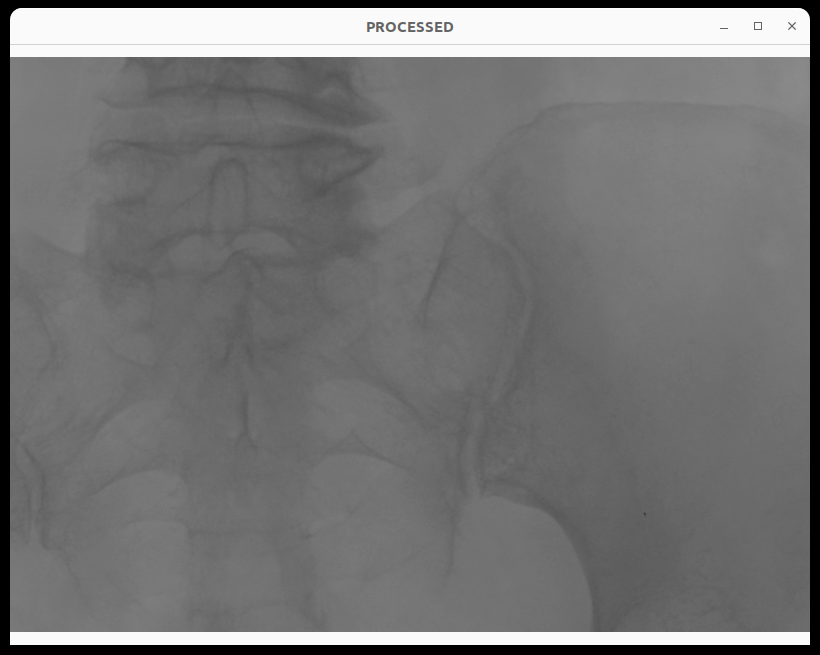
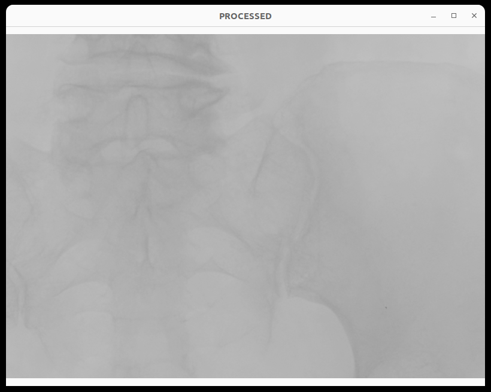
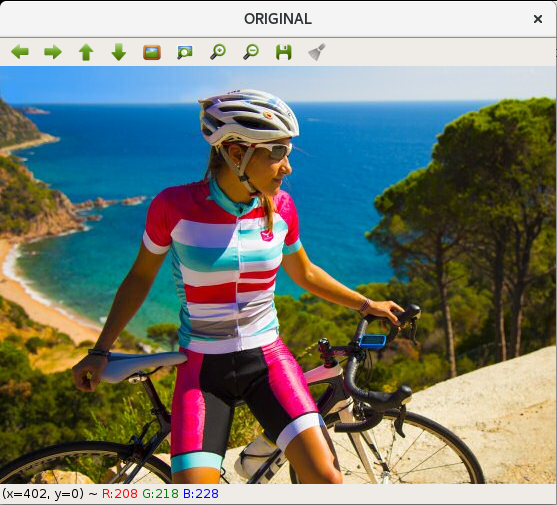
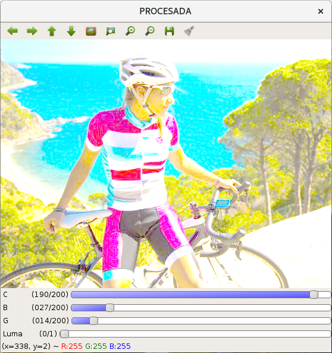
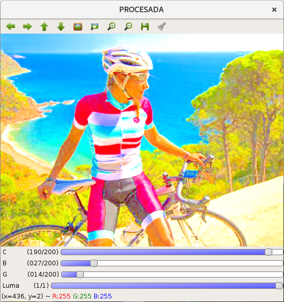

# Control del brillo, contraste y gamma de la imagen digital

> © 2023- F.J. Madrid Cuevas (fjmadrid@uco.es). Universidad de Córdoba. España.

---

## 🎯 Objetivos de la práctica

* Aprender a mejorar una imagen aplicando un proceso puntual de la imagen.
* Aprender a convertir entre tipos de datos para el píxel.
* Aprender a desentrelazar/entrelazar canales en una imagen (`cv::split` y `cv::merge`).
* Aprender a convertir entre los espacios de color BGR $\leftrightarrow$ HSV.

---

## 📖 Descripción

Desarrollar un programa que cargue una imagen (puede ser monocroma o en color) para ajustar el **brillo**, **contraste** y **gamma** de la misma según la siguiente ecuación de transformación puntual:

$$I'\;=\;c \times I^g + b$$

donde:
* **$I$** es la imagen de entrada normalizada en el intervalo $[0.0, 1.0]$.
* **$I'$** es la imagen de salida también en el intervalo $[0.0, 1.0]$.
* **$c$** altera el **contraste** entre tonos (factor de escala multiplicativo).
* **$b$** aplica un offset para alterar el **brillo** general de la imagen (desplazamiento aditivo).
* **$g$** es el valor **gamma** que controla la no linealidad de la transformación.

---

### Figura 1. Ejemplos de variación de parámetros

| (a) Imagen Original | (b) Aumento del contraste $\times 1.5$ |
| :---: | :---: |
|  |  |
| **(c) Aumento del brillo $+0.25$** | **(d) Gamma $= 1.5$** |
|  |  |
| **(e) Gamma $= 0.66$** | |
|  | |

> **Figura 1.** Ejemplos al aplicar cambios al contraste *(b)*, el brillo *(c)* y el gamma *(d)* y *(e)*.

---

## 🎨 Procesamiento en color: "Full RGB" vs "Solo Luma"

Si la imagen de entrada usa el espacio de color RGB, el proceso se puede aplicar por igual a los tres canales (*ver Figura 2b*). Sin embargo, esta forma de trabajar puede alterar el "tono" y la saturación de los colores.

Alternativamente, cuando una imagen es RGB se puede:
1. Convertir la imagen al espacio de color **HSV**.
2. Desentrelazar los canales (`cv::split`).
3. Procesar únicamente el canal **$V$** (luminancia/brillo) con la ecuación $V' = c \times V^g + b$.
4. Reentrelazar los canales (`cv::merge`) y deshacer el cambio al espacio de color RGB.

Se puede observar cómo al procesar únicamente el canal $V$, la imagen obtenida mantiene unos matices de color mucho más próximos y naturales respecto a la imagen original (*ver Figura 2c*).

---

### Figura 2. Comparación entre procesado completo y solo canal V

| (a) Imagen original | (b) Procesado "full" RGB | (c) Procesado "solo luma" (V) |
| :---: | :---: | :---: |
|  |  |  |

> **Figura 2.** Ejemplos de la aplicación en modo interactivo. *(b)* Resultado de procesar la imagen RGB directamente en cada canal por separado. *(c)* Resultado de procesar la imagen RGB procesando únicamente el canal "luma" ($V$) extraído de la versión HSV. *Observar la diferencia en el matiz del tono "rojo" en el maillot del ciclista.*

---

## 📊 Evaluación

| Concepto | Puntos |
| :--- | :---: |
| `test_common_code` | hasta **5** |
| Explicación de la técnica y justificación en modo interactivo de los cambios cuando varían los parámetros de $c$, $b$ y $g$ con la imagen del ciclista, en especial el parámetro $g$ y la comparación de procesar el color con "solo luma" vs "todos los canales". | hasta **5** |

---

## 🔗 Recursos útiles de OpenCV

* [Método `cv::Mat::convertTo` para convertir entre tipos de píxel y escalar valores](https://docs.opencv.org/4.x/d3/d63/classcv_1_1Mat.html#adf88c60c5b4980e05bb556080916978b)
* [Función `cv::cvtColor` para conversiones entre espacios de color](https://docs.opencv.org/3.4.7/d8/d01/group__imgproc__color__conversions.html#ga397ae87e1288a81d2363b61574eb8cab)
* [Funciones `cv::split` y `cv::merge` para desentrelazar y entrelazar canales](https://docs.opencv.org/3.4/d2/de8/group__core__array.html#ga0547c7fed86152d7e9d0096029c8518a)
* [Operaciones matemáticas con `cv::Mat` (`cv::pow`, etc.)](https://docs.opencv.org/3.4/d2/de8/group__core__array.html)
* [Tutorial OpenCV: Adding a Trackbar to our applications](https://docs.opencv.org/3.4/da/d6a/tutorial_trackbar.html)
