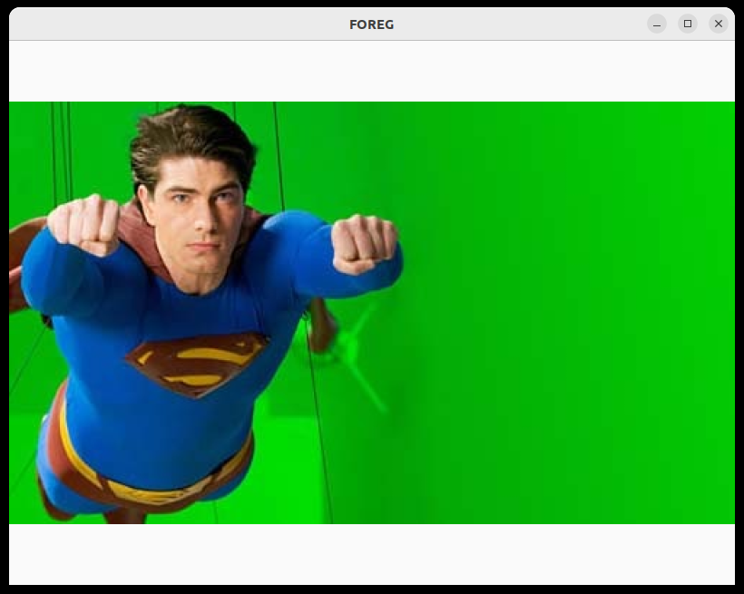
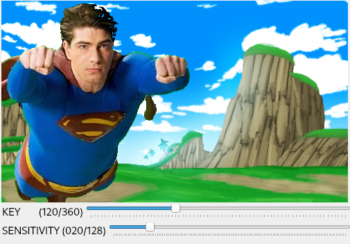
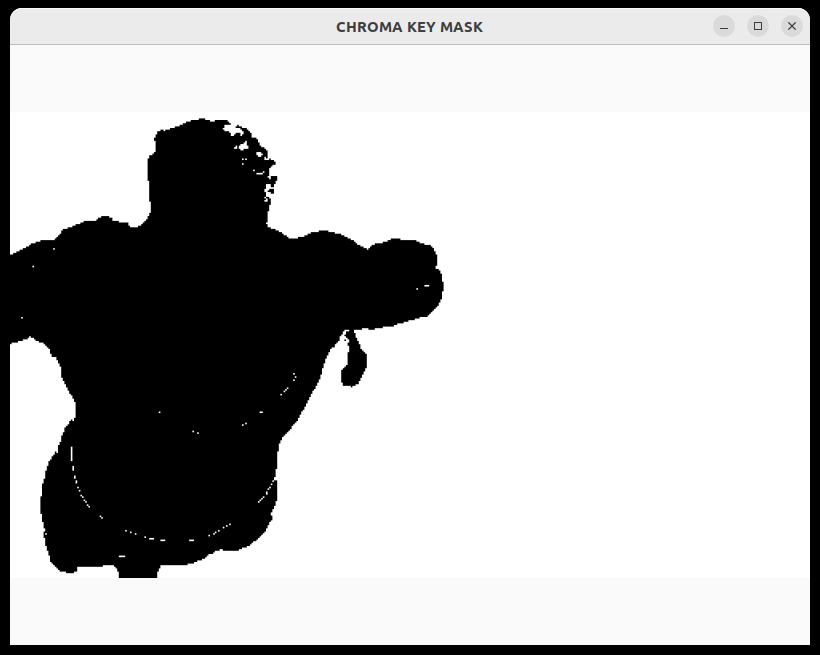
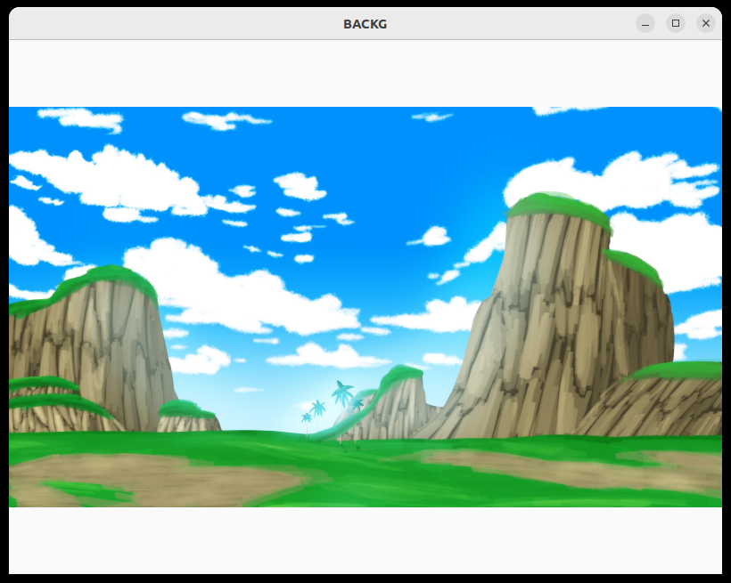

# Composición de imágenes usando color (chroma key)

> © 2023- F.J. Madrid Cuevas (fjmadrid@uco.es). Universidad de Córdoba. España.

---

## 🎯 Objetivos de la práctica

* Aprender a generar una máscara seleccionando un rango de valores válidos en varios canales.
* Aprender a combinar dos imágenes usando operadores de bit.
* Aprender a combinar dos imágenes usando una máscara.
* Aprender a redimensionar una imagen.
* Aprender a convertir el espacio de color RGB a HSV.

---

## 📖 Descripción

Se trata de desarrollar un programa que permita combinar dos imágenes: **$F$ (primer plano)** y **$B$ (fondo)** para simular que la imagen $F$ está en el entorno representado por la imagen $B$ (*ver Figura 1*).

Para ello se asume que la imagen $F$ tiene un fondo con un color “único” conocido (**chroma key**) que indica las áreas donde copiar los píxeles correspondientes de la imagen $B$.

Para facilitar la selección de píxeles en función de un color se va a utilizar el espacio de color **HSV** usando el canal **H** para indicar el color clave (*chroma key*).

Debido al ruido, una mala iluminación o cambios en la reflectividad de los materiales es muy difícil que el valor de *chroma key* sea un único valor. Por lo tanto se proporciona un rango de tonos (*hue*) en el espacio de color HSV para definir los valores válidos para *chroma key*. Este rango se define como:

$$\text{chroma key range} = [(h - s, h + s), (0, 1), (0, 1)]$$

donde **$h$** es el valor nominal de *chroma key* (por ejemplo $120$ para el verde) y **$s$** es la sensibilidad medida como número de tonos.

---

### Figura 1. Ejemplo de combinación usando un tono como clave de color

| (a) Primer plano con fondo clave | (b) Fondo a insertar |
| :---: | :---: |
|  |  |
| **(c) Máscara generada ($h=120, s=20$)** | **(d) Imagen combinada resultante** |
|  |  |

> **Figura 1.** *(a)* Imagen con el primer plano y un fondo con el tono clave. *(b)* Imagen usada como fondo. *(c)* Imagen con la máscara generada con un tono clave $h=120$ y una sensibilidad $s=20$, donde los píxeles con valor $255$ pertenecen al rango HSV $[120 \pm 20, 0-1, 0-1]$. *(d)* Imagen resultado de la combinación de *(a)* con *(b)* usando *(c)* como máscara.

---

## 🔄 Tratamiento circular del canal Hue

Hay que tener en cuenta que la característica **$H$ es circular** por lo que, al aplicar el valor de sensibilidad, se puede producir un desborde del límite inferior si $(h - s) < 0$ o del límite superior si $(h + s) > 360$. En estos casos hay que generar dos rangos y combinarlos en una sola máscara:

* **Si $(h - s) < 0$**: se deben seleccionar los rangos:
  $$[(h - s + 360, 360), (0, 1), (0, 1)] \quad \text{y} \quad [(0, h + s), (0, 1), (0, 1)]$$

* **Si $(h + s) > 360$**: se deben seleccionar los rangos:
  $$[(h - s, 360), (0, 1), (0, 1)] \quad \text{y} \quad [(0, h + s - 360), (0, 1), (0, 1)]$$

Para poder combinar las imágenes $F$ y $B$, estas deben tener el mismo tamaño. Si esto no fuera así, habría que redimensionar previamente una de ellas (por ejemplo la imagen $B$) para que tuvieran el mismo tamaño a la hora de combinarse para generar la imagen de salida.

---

## 📊 Evaluación

| Concepto | Puntos |
| :--- | :---: |
| `test_common_code` | hasta **5** |
| Vídeo con la explicación de la técnica y ejemplos de ejecución en modo interactivo justificando los resultados al cambiar los parámetros de entrada en la GUI. | hasta **5** |

---

## 🔗 Recursos OpenCV

* [Función para convertir espacios de color (`cv::cvtColor`)](https://docs.opencv.org/3.4.7/d8/d01/group__imgproc__color__conversions.html#ga397ae87e1288a81d2363b61574eb8cab)
* [Función para seleccionar un rango (`cv::inRange`)](https://docs.opencv.org/3.4.18/d2/de8/group__core__array.html#ga48af0ab51e36436c5d04340e036ce981)
* [Función para redimensionar una imagen (`cv::resize`)](https://docs.opencv.org/3.4.18/da/d54/group__imgproc__transform.html#ga47a974309e9102f5f08231edc7e7529d)
* [Método `cv::Mat::copyTo` para combinar dos imágenes usando una máscara](https://docs.opencv.org/4.5.0/d3/d63/classcv_1_1Mat.html#a626fe5f96d02525e2604d2ad46dd574f)
