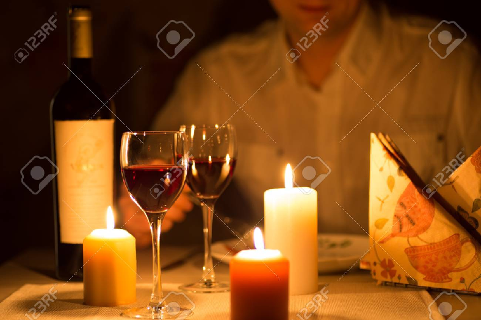
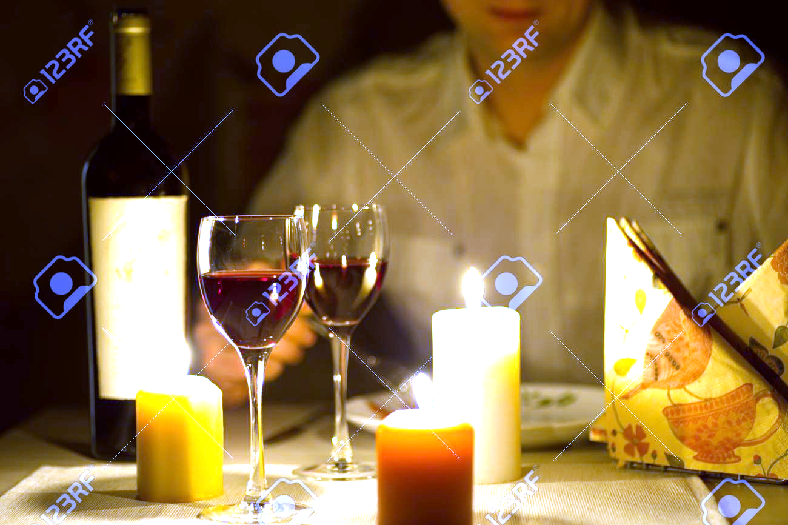
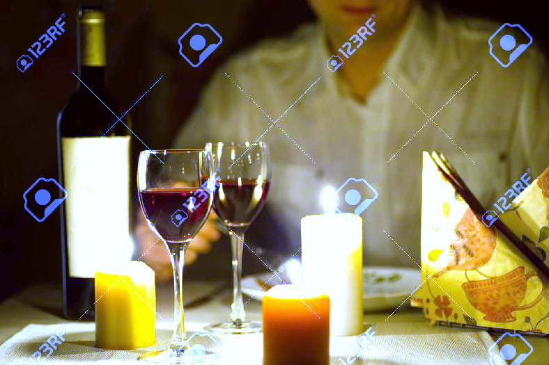

# Equilibrado del color

© 2021- F.J. Madrid Cuevas (fjmadrid@uco.es). Universidad de Córdoba. España.

## Objetivos

- Aplicar varias técnicas de procesado puntual a la imagen para equilibrar el color.
- Aprender métodos para obtener estadísticas de áreas de la imagen usando una máscara.

## Descripción

Una de los desperfectos que pueden ocurrir en el sistema de captura es que los colores obtenidos no se correspondan con los “reales” o esperados. Por ejemplo si observamos la imagen de una pared blanca esta se muestra con alguna desbalance de color hacia algún tono. Esto puede ocurrir debido a la iluminación (por ejemplo, la toma se realiza al amanecer o al atardecer) o algún fallo del sensor. Las técnicas de procesado que intentan corregir estas deficiencias se denomina “equilibrado del color”.

## White Patch

La técnica de equilibrado del color “White Patch” busca corregir deficiencias en la iluminación (o del hardware) que hace que una superficie blanca (“White patch”) refleje luz con tono RGB distinto de $(255,255,255)$.

Para ello la técnica localiza el punto más luminoso en la imagen, $W^*$, que tendría que coincidir con un punto sobre un área que tendría que verse blanca (por ejemplo una pared) y escalar la imagen de entrada $I$ para conseguir que dicho punto quede como blanco $(255,255,255)$ en la imagen de salida $O$:

$$O = \alpha \cdot I, \quad \text{siendo } \alpha = \left( \frac{255}{W_R^*}, \frac{255}{W_G^*}, \frac{255}{W_B^*} \right)$$

En la Figura 1b se muestra un ejemplo de esta técnica.

Para seleccionar el punto blanco podemos optar a hacerlo de forma manual, donde el usuario pulsará con el botón izquierdo del ratón sobre un punto de la imagen, o de forma automática, donde el punto blanco será seleccionado como aquel con mayor iluminación. Nótese que dado un color RGB, su iluminación puede calcularse como la suma ponderada

$$Y = 0.299 R + 0.587 G + 0.114 B$$

La versión automática tiene un inconveniente: puede ocurrir que debido a la presencia de zonas saturadas de iluminación, bien por brillos especulares, bien por una mala configuración de la apertura del diafragma, bien por que se corresponden con fuentes de luz (por ejemplo una llama), bien por la presencia de ruido en especial multiplicativo, se producen valores espurios (“outliers”) que no tienen relación con la escena. En estos casos el valor del punto más luminoso suele coincidir con uno de estos outliers cuyos valores estarán próximos a $(255, 255, 255)$ y por lo tanto la técnica no funcionará correctamente.

Una forma más robusta de estimar el punto más luminoso es utilizar el valor RGB promedio $\bar{W}^*$ obtenido a partir de un porcentaje $P$ de los puntos más luminosos en la escena. La idea es que en esta estimación es menos sensible a los “outliers”. Ahora el factor de escala a aplicar sería

$$\alpha = \left( \frac{255}{\bar{W}_R^*}, \frac{255}{\bar{W}_G^*}, \frac{255}{\bar{W}_B^*} \right)$$

En la Figura 1c se muestra un ejemplo.

| (a) Imagen original | (b) Corrección “White Patch” usando el píxel más luminoso. | (c) Corrección “White Patch” usando el promedio del 25% de píxeles más luminosos. |
| :---: | :---: | :---: |
|  |  |  |

**Figura 1.** Ejemplo de aplicación de la corrección “White Patch”. (a) Imagen original con valores “espurios” debido a la saturación en la llama de las velas. (b) Corrección “White Patch” usando el píxel más luminoso. En este caso será un píxel saturado situado en el área de las llamas con color próximo a $(255,255,255)$ y por tanto no se realiza corrección alguna (observar la camisa). (c) Corrección “White Patch” usando el color promedio del 25% de los píxeles más luminosos. Observar como el color blanco de la camisa o la etiqueta de la botella está mejor normalizado.

## Gray World

Como no siempre puede suponerse que en la escena hay una área blanca, otra alternativa, conocida como “Gray World” (el mundo es gris), consiste en calcular el color promedio $\bar{G}$ en la imagen asumiendo que, en una situación ideal, este tono promedio debería ser $(128,128,128)$ o gris neutro. Por lo tanto se escala la imagen de entrada con el factor

$$\alpha = \left( \frac{128}{\bar{G}_R}, \frac{128}{\bar{G}_G}, \frac{128}{\bar{G}_B} \right)$$

Una ventaja de esta técnica respecto a “White Patch” es que es completamente automática y muy robusta. En la Figura 2b se muestra un ejemplo de esta técnica.

| (a) Imagen original. | (b) Corrección “Gray World”. |
| :---: | :---: |
|  |  |

**Figura 2.** Ejemplos de corrección del balance de color “Gray World”. a) Imagen original sin equilibrio de color. b) Corrección “Gray World”.

## Evaluación

| Concepto | Puntos |
| --- | --- |
| `test_common_code` | hasta 5 |
| En el vídeo se justifican los cambios observados al variar los parámetros con la imagen “cena-romántica-con-velas-y-vino.jpg” | hasta 5 |

## Recursos

- Localización de máximos y mínimos `cv::minMaxLoc()`.
- Obtención del valor medio de una imagen `cv::mean()`.
- Tipo de dato para definir escalares para varios canales `cv::Scalar`.
- Función para convertir espacios de color `cv::cvtColor()`.
