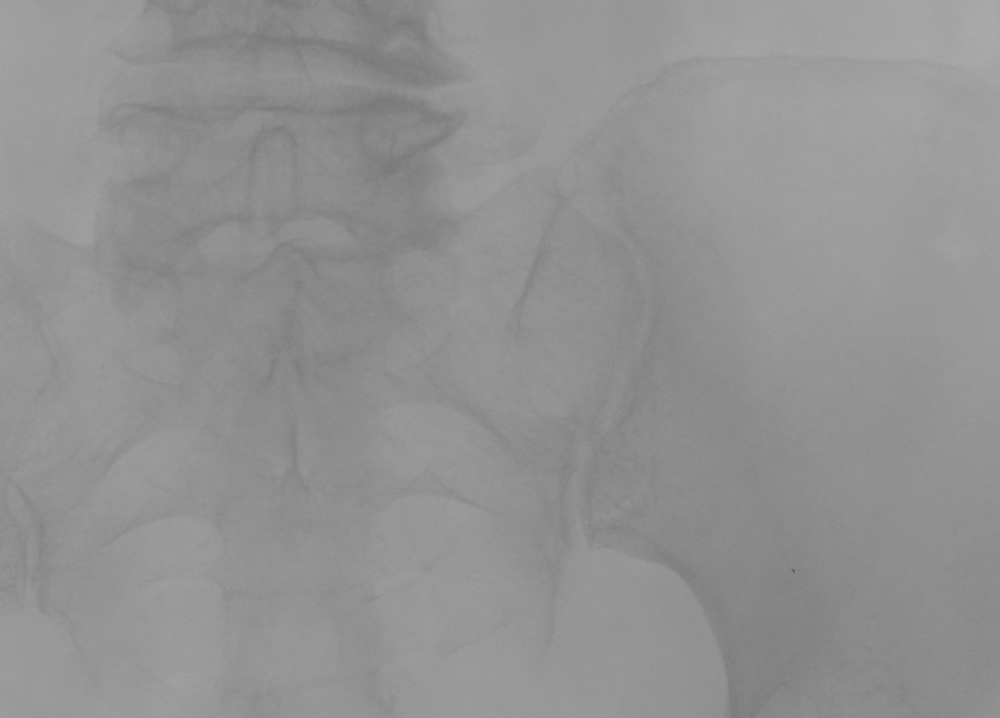
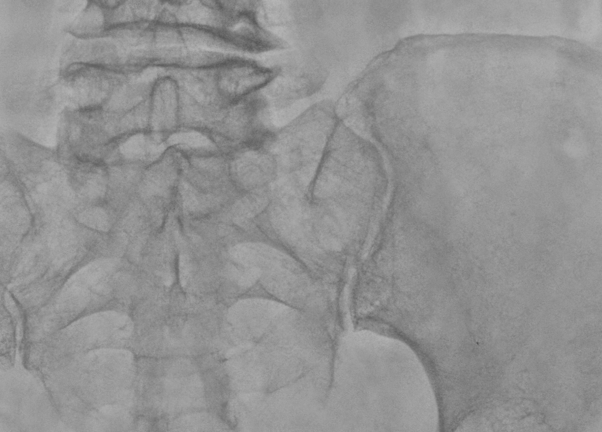
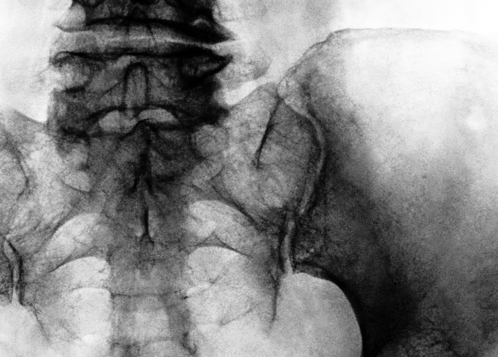
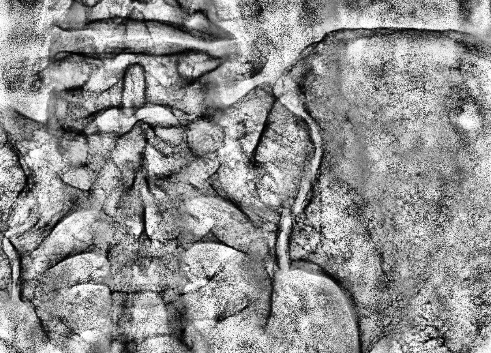

# Ecualización de la imagen

© 2021- F.J. Madrid Cuevas (fjmadrid@uco.es). Universidad de Córdoba. España.

## Objetivos de la práctica

* Aprender a mejorar una imagen aplicando ecualización del histograma.
* Comprobar la diferencia entre métodos de procesado globales y locales.

## Descripción

La ecualización de la imagen es una operación de procesamiento que busca aumentar el contraste en la misma.

El funcionamiento básico consiste en aplicar la operación

$$O(x,y) = 255 \cdot T [I(x,y)]$$

donde $I$, $O$ son las imágenes de entrada y salida y $T$ es una función de transformación que se obtiene a partir de el histograma normalizado (norma $L1=1.0$) y acumulado de la imagen de entrada $I$. Cuando esta tabla se aplica a todos los puntos de la imagen se denomina ecualización global (ver Figura 1b). La justificación del uso de esta función de transformación puedes verla en [1].

### Ecualización local

El problema de la ecualización global es que el histograma de la imagen puede ser muy diferente al que podemos obtener si nos centramos en una parte de la misma.

Para corregir este problema podemos aplicar el proceso de forma local utilizando una ventana de tamaño $(2 \cdot r+1, 2 \cdot r+1)$, siendo '$r$' el radio de la ventana. Para cada posible posición de la ventana se calcula la función de transformación correspondiente $T$ usando el histograma de dicha ventana y sólo se transforma el píxel central de la misma (ver Figura 1c). Para más detalles ver la referencia [2].

| | | |
|:---:|:---:|:---:|
|  |  |  |

**Figura 1:** a) Imagen de entrada. b) ecualización global. c) ecualización local con $r=32$. Observar cómo, en el procesado local, el ruido en la imagen también se realza.

---

## Limitación del contraste

Un problema de la ecualización local es que podemos encontrarnos con zonas con bajo contraste, es decir, con histogramas muy concentrados en unos pocos valores. Estas zonas tendrán un aumento del contraste muy significativo en el resultado donde el ruido estará muy magnificado (ver Fig. 1c).

Para reducir este efecto no deseado podemos utilizar una técnica que limitará el contraste mediante un recorte del histograma a un valor "$CL$" deseado y posterior reparto del área recortada de forma equitativa entre todos los bins del histograma (ver Fig. 2).

**Figura 2:** Ejemplo de recorte de un histograma y su efecto en la función de transformación. (Tomado de ["Adaptive Histogram Equalization and Its Variations"](https://doi.org/10.1016/S0734-189X(87)80186-X))

Para obtener el valor de recorte $CL$ usaremos la expresión:

$$CL = s \times \text{area}(hist) / \text{bins}(hist)$$

donde el parámetro "$s$" representa la pendiente de la función de transformación deseada.

Sin embargo, si al recortar el histograma sumamos el área residual repartida, el histograma recortado tendrá valores por encima del valor $CL$ deseado por lo tanto, dado un valor $CL$ deseado debemos recortar el histograma a un $P$ tal que:

$$CL = P + R/\text{bins}(hist)$$

donde "$R$" será el área residual resultante de recortar el histograma al valor "$P$". Para encontrar este valor podemos utilizar el algoritmo mostrado en la Figura 3.

**Figura 3:** Algoritmo para calcular el valor efectivo "P" para recortar un histograma cuando el valor de recorte deseado es "CL".

Los valores razonables para el parámetro '$s$' están en el rango $[3, 6]$. Comparando las Figuras 1c y 4c se puede observar la ventaja de la aplicación de la limitación del contraste en la ecualización local.

| | | |
|:---:|:---:|:---:|
|  |  |  |

**Figura 4:** Ejemplo comparativo de la ecualización global clásica con la ecualización local (radio=32) con limitación de contraste ($s=4.0$).

---

## Evaluación

La práctica se evaluará según la siguiente tabla:

| Concepto/Función. | Puntos |
| :--- | :--- |
| `test_common_code` | hasta 5.0 |
| Video explicando la técnica y ejemplos de ejecución justificando los resultados variando los parámetros. Utiliza imagen "avion.png" | hasta 5.0 |

---

## Referencias y recursos

* [1] Concepto ["Ecualización del histograma"](https://es.wikipedia.org/wiki/Ecualizaci%C3%B3n_del_histograma).
* [2] Concepto ["Adaptive Histogram Equalization"](https://en.wikipedia.org/wiki/Adaptive_histogram_equalization).
* Función `cv::calcHist` para cálculo del histograma.
* Función `cv::sum()` para obtener el área del histograma.
* Función `cv::normalize` para normalizar matrices de distintas formas.
* Métodos de la clase `cv::Mat` para obtener sub-matrices (rangos o ventanas).
