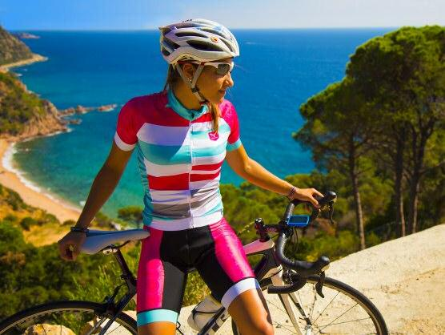
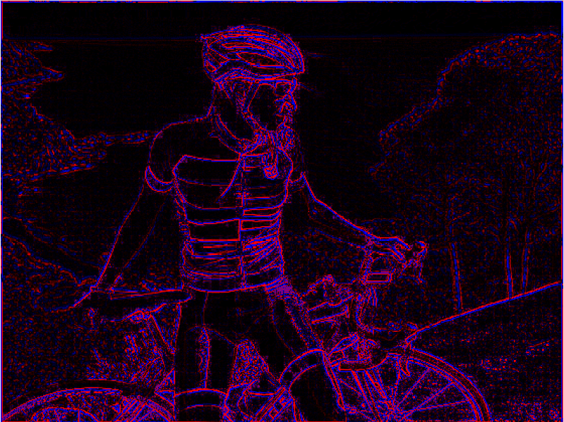
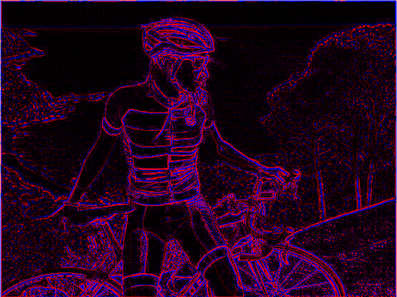
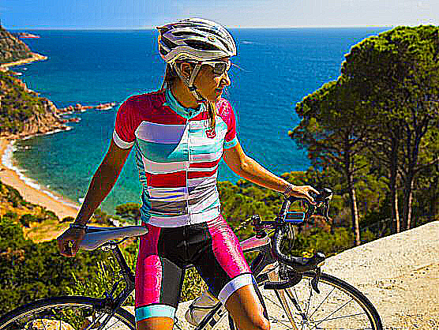
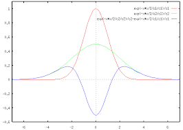
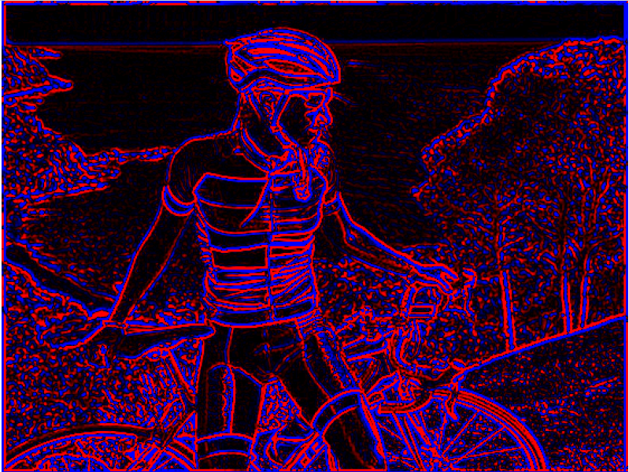

# Realce de imagen usando un filtro de enfoque (Sharpening)

© 2021- F.J. Madrid Cuevas (fjmadrid@uco.es). Universidad de Córdoba. España.

## Objetivos de la práctica
* Aprender a mejorar una imagen aplicando un filtrado con el filtro de enfoque.
* Aprender a aplicar una convolución a la imagen.
* Aprender a construir filtros paso banda (Laplaciano y DoG).

## Descripción

Recuerda que una señal digital (una imagen por ejemplo) puede descomponerse en versiones de la misma en distintas frecuencias y en general podríamos simplificar diciendo que $I = I_l + I_h$, donde $I_l, I_h$ son las versiones de baja y alta frecuencia respectivamente de la imagen. Las bajas frecuencias representan las estructuras de mayor escala de la imagen y las altas frecuencias los detalles de menor escala.

La técnica de realce denominada “sharpening” consiste en realizar la imagen $I$ usando la siguiente operación:

$$O = I + I_h \quad (1)$$

es decir, sumamos a la imagen una versión de las altas frecuencias y por lo tanto los detalles de las misma (también el ruido) ganan peso por lo que la imagen resultante $O$ tendrá realzados estos detalles.

## Filtro Laplaciano

Para obtener la versión de alta frecuencia de la imagen podremos utilizar un filtro que aproxime el operador Laplaciano $\nabla^2$ de tal forma que la versión de alta frecuencia de la imagen será:

$$I_h \approx -\nabla^2 \otimes I$$

En la Figura 1a y 1b se muestran dos posibles versiones del filtro laplaciano usando un entorno de vecindad con cuatro o ocho puntos respectivamente.

## Filtro de enfoque

La operación (Eq. 1) puede realizarse en un solo paso si tenemos en cuenta que la convolución $\otimes$ es una operación lineal y asociativa respecto a la suma:

$$O = [1] \otimes I + (-\nabla^2 \otimes I)$$
$$O = ([1] + (-\nabla^2)) \otimes I$$
$$O = S \otimes I$$

donde $[1]$ sería un filtro con todos los valores a cero salvo el valor central $1.0$ y $S$ será el filtro de enfoque (“sharpening”) $S = [1] + (-\nabla^2)$.

En la Figura 1c y 1d se muestran dos versiones del filtro de enfoque $S$ según se use el laplaciano de 4 o de 8 puntos. En la Figura 2 se muestran dos resultados de aplicar ambas versiones.

| (a) 4 puntos | (b) 8 puntos |
| :---: | :---: |
| $$\begin{bmatrix} 0 & 1 & 0 \\ 1 & -4 & 1 \\ 0 & 1 & 0 \end{bmatrix}$$ | $$\begin{bmatrix} 1 & 1 & 1 \\ 1 & -8 & 1 \\ 1 & 1 & 1 \end{bmatrix}$$ |

| (c) Sharpening (4 puntos) | (d) Sharpening (8 puntos) |
| :---: | :---: |
| $$\begin{bmatrix} 0 & -1 & 0 \\ -1 & 1+4 & -1 \\ 0 & -1 & 0 \end{bmatrix}$$ | $$\begin{bmatrix} -1 & -1 & -1 \\ -1 & 1+8 & -1 \\ -1 & -1 & -1 \end{bmatrix}$$ |

**Figura 1:** (a) y (b) Filtros Laplaciano $\nabla^2$ de 4 y 8 puntos respectivamente. (c) y (d) Filtro de enfoque (“Sharpening”) $S = [1] + (-\nabla^2)$ usando las versiones del filtro Laplaciano de 4 y 8 puntos respectivamente.

---

### Ejemplo de Realce

| (a) Imagen original |
| :---: |
|  |

| (b) Convolución Laplaciano (4 ptos) | (c) Realce Laplaciano (4 ptos) |
| :---: | :---: |
|  |  |

| (d) Convolución Laplaciano (8 ptos) | (e) Realce Laplaciano (8 ptos) |
| :---: | :---: |
|  |  |

**Figura 2:** Ejemplo de realce usando el filtro de enfoque “sharpening”. (a) Imagen original, (b) Convolución de (a) con el Laplaciano de 4 puntos (se aplica al canal luma y escalado. Valores negativos en azul, positivos en rojo) y (c) realce usando el laplaciano de 4 puntos. (d) Convolución de (a) con el Laplaciano de 8 puntos y (e) realce usando el laplaciano de 8 puntos.

---

## Filtros paso banda (DoG)

Alternativamente, podemos crear filtros paso banda para realzar sólo una banda de frecuencias, para ello podemos utilizar un filtro DoG (Difference of Gaussians) para aproximar el operador Laplaciano $\nabla^2$:

$$\nabla^2 \approx DoG(\sigma_1, \sigma_2) = G_{\sigma_2} - G_{\sigma_1}, \quad \sigma_1 < \sigma_2$$

donde $G$ sería un filtro gaussiano. Así el filtro de enfoque sería $S = [1] + (-DoG)$. La Figura 3 muestra un filtro DoG y el resultado de aplicar un realce a una imagen con un filtro de enfoque $S$ basado en el filtro DoG.

| (a) Filtro DoG |
| :---: |
|  |

| (b) Convolución DoG | (c) Realce DoG |
| :---: | :---: |
|  |  |

**Figura 3:** Filtro DoG. (a) Ejemplo de filtro DoG (azul) construido como la diferencia de dos filtros gausianos (cian menos rojo). (b) Convolución de la imagen Fig.2(a) con un filtro DoG con $\sigma_1=1.0$ y $\sigma_2=2.0$ (se aplica al canal luma. Valores negativos en azul y positivos en rojo). (c) Realce usando un filtro de enfoque S basado en el filtro DoG.

---

## Evaluación

| Concepto | Puntos |
| :--- | :--- |
| `test_common_code` | hasta 5 |
| Video explicando la técnica y justificación de los resultados al cambiar los parámetros de entrada en la gui usando la imagen “cells.png”. | hasta 5 |

## Recursos

* [Operador DoG (Difference of Gaussians)](#).
* Para generar el filtro gaussiano: [`cv::getGaussianKernel()`](https://docs.opencv.org/master/d4/d86/group__imgproc__filter.html#gac05b16e47615692ee3c8801d0ad5d688).
* Función [`cv::copyMakeBorder`](https://docs.opencv.org/master/d2/de8/group__core__array.html#ga2ac4149fdef4238c37219600c7f933fd) para extender una imagen.
* Función [`cv::filter2D`](https://docs.opencv.org/master/d4/d86/group__imgproc__filter.html#ga27c049795ce870216ddfb366086b5a04) para el filtrado.
