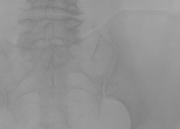
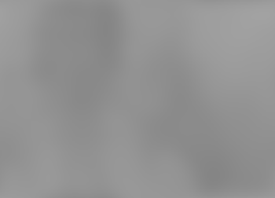
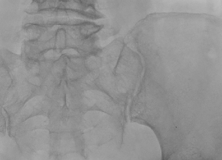
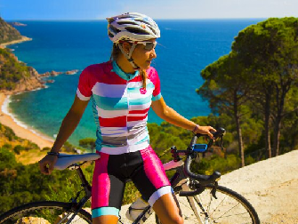
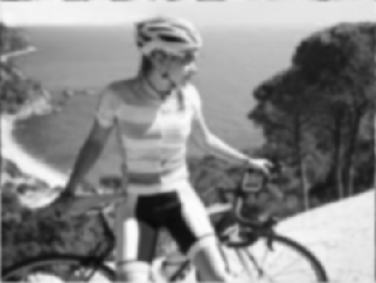
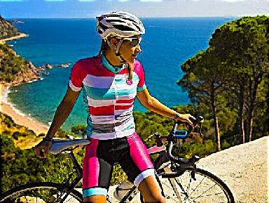

# Realce usando la máscara de desenfoque

© 2021- F.J. Madrid Cuevas (fjmadrid@uco.es). Universidad de Córdoba. España.

## Objetivos de la práctica

* Aprender a mejorar una imagen aplicando un realce por máscara de desenfoque (*unsharp mask*).
* Aprender a aplicar un cambio de espacio de color.
* Aprender a aplicar una convolución a la imagen.
* Aprender a utilizar la GUI de OpenCV usando controles con barra de deslizamiento.

## Descripción

Vamos a realizar un realce de la imagen (mejorar el contraste de los detalles) usando la máscara de desenfoque (“unsharp mask”). La operación a realizar es:

$$O = (g + 1) \cdot I - g \cdot I_L \quad \text{(ecu. 1)}$$

siendo $I$ la imagen original, $I_L$ la versión de bajas frecuencias de la misma y el parámetro “$g$” es una constante que define la ganancia del realce (ver Figura 1).

La versión de baja frecuencia de la imagen $I_L$ se obtiene usando filtrado lineal con un filtro paso baja como pueden ser el filtro Caja o el filtro Gaussiano. El filtro tendrá un tamaño $2 \cdot r + 1$ siendo el parámetro “$r$” el radio del filtro.

| a) original. | b) “Unsharp mask”. | c) Resultado. |
| :---: | :---: | :---: |
|  |  |  |

**Figura 1.** Ejemplo de realce usando máscara de desenfoque: **a)** Imagen monocroma original. **b)** Máscara creada usando un filtro gaussiano con radio=60 y expansión circular. **c)** Resultado del resalte usando una ganancia de 1.5.

---

## Fundamento de la técnica

Como ya se ha comentado en clase, una imagen $I$ como señal digital se puede representar como la suma ponderada de infinitas señales “básicas” y a groso modo, como la superposición de una versión de bajas frecuencias “$I_L$” (la estructura general de la escena) con su versión de altas frecuencias “$I_H$” (los detalles de la escena), es decir que podemos decir:

$$I = (I_L + I_H) \quad \text{(ecu. 2)}$$

Ahora, si introducimos la ecu. 2 en la ecu. 1 tendremos:

$$O = (g + 1) \cdot (I_L + I_H) - g \cdot I_L$$

y expandiendo y recombinando:

$$O = g \cdot I_L + g \cdot I_H + I_L + I_H - g \cdot I_L = (I_L + I_H) + g \cdot I_H = I + g \cdot I_H,$$

es decir, la imagen de salida $O$ es una versión de la imagen de entrada $I$ con los detalles “resaltados” según la ganancia “$g$” seleccionada.

## Procesado RGB

Si la imagen de entrada está en color, se puede aplicar el proceso a cada canal RGB por separado pero esto puede tener como consecuencia que se alteren los tonos. Una alternativa es cambiar su espacio de color a otro que separe el “luma”, por ejemplo HSV, aplicar el realce sólo al canal “luma” y se deshace el cambio a RGB con el canal “luma” realzado (ver `cv::cvtColor`) (ver Figura 2).

| a) Original. | b) “Unsharp mask”. | c) Resultado. |
| :---: | :---: | :---: |
|  |  |  |

**Figura 2.:** Ejemplo de aplicación en una imagen en color. **a)** Imagen en color RGB. **b)** Máscara creada sobre el canal V de la versión HSV de la entrada usando un filtro gaussiano con r=7. **c)** realce obtenido usando una ganancia 2.0.

---

## Evaluación

| Función implementada. | Puntos. |
| :--- | :--- |
| `test_common_code` | hasta 5 |
| Justificación de los resultados al cambiar los parámetros de entrada en la gui en el vídeo usando la imagen “cells.png”. | hasta 5 |

## Recursos.

* Expansión de una imagen: `cv::copyMakeBorder()`.
* Combinar imágenes: `cv::addWeighted()`.
* Acceso a una ventana de una imagen: `cv::Mat::operator()`.
* Función para convertir espacios de color: `cv::cvtColor()`.
